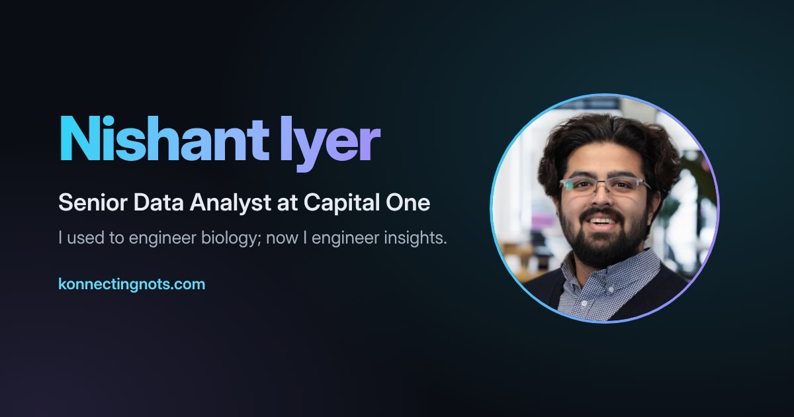

# konnectingnots.com

Personal portfolio of **Nishant Iyer**, Senior Data Analyst at Capital One.

**Live site:** https://www.konnectingnots.com



## What's here

- **Home** (`index.html`): about, tools, experience timeline, projects and a contact form.
- **Case studies** (`projects/`): long-form write-ups of the credit card fraud and wellbore geology projects.

Plain HTML, CSS and a little JavaScript. No build step, no framework, no dependencies beyond Google Fonts. Light and dark themes follow the visitor's system setting and can be toggled.

## Editing

| To change… | Edit |
|---|---|
| Text, jobs, projects | `index.html` (all content is in the HTML so search engines can read it) |
| Colors, spacing, fonts | the tokens at the top of `style.css` |
| A case study | `projects/*.html` |
| Résumé | replace `assets/Resume.pdf` |

Images live in `assets/img` (project thumbnails and profile photo), `assets/logos` and `assets/case`. Keep new images as WebP at roughly the size they display, ideally under 150 KB each.

### Contact form

The form posts to [Web3Forms](https://web3forms.com) (free). Put your access key in the hidden `access_key` field in `index.html`. Until a key is set, submitting the form opens the visitor's email app instead.

## Run locally

```bash
python3 -m http.server 8000
# then open http://localhost:8000
```

## Deploy

GitHub Pages serves the `main` branch. The `CNAME` file points it at `www.konnectingnots.com`.
