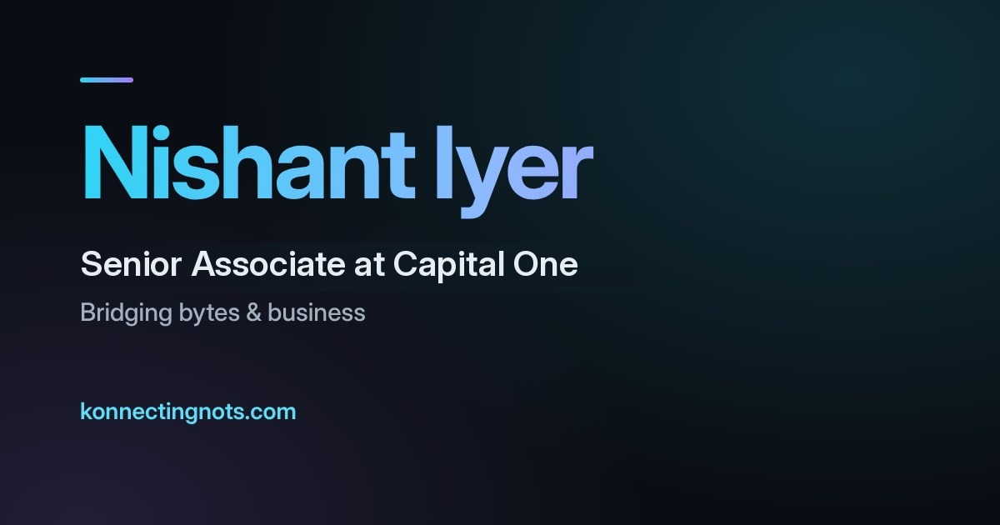

# konnectingnots.com

Personal portfolio of **Nishant Iyer**, Senior Associate at Capital One.

**[Visit the live site](https://www.konnectingnots.com)**



## What's here

- **Home** (`index.html`): about, tools, experience timeline and projects.
- **Case studies** (`projects/`): long-form write-ups of each project (fraud detection, wellbore geology, distribution centers, NFL betting, Bellion and airline satisfaction).

Plain HTML, CSS and a little JavaScript. No build step, no framework, no dependencies beyond Google Fonts. Light and dark themes follow the visitor's system setting and can be toggled.

## Travel book (`travel/`)

A guide to every place in the USA, served at **travel.konnectingnots.com** (and `/travel/`): 6,591 destinations from Wikivoyage with things to do, food, best time to visit, budget, itineraries, Google Maps links, photos from Wikimedia Commons, and a personal journal saved in the visitor's browser. The pages are generated; don't hand-edit them. Text is CC BY-SA 4.0 from Wikivoyage contributors (credited on every page).

## Editing

| To change… | Edit |
|---|---|
| Text, jobs, projects | `index.html` (all content is in the HTML so search engines can read it) |
| Colors, spacing, fonts | the tokens at the top of `style.css` |
| A case study | `projects/*.html` |
| Résumé | replace `assets/Resume.pdf` |
| After changing `style.css` or `script.js` | bump the `?v=` number where each page links them, so browsers fetch the new file |

Images live in `assets/img` (project thumbnails and profile photo), `assets/logos` and `assets/case`. Keep new images as WebP at roughly the size they display, ideally under 150 KB each.

## Run locally

```bash
python3 -m http.server 8000
# then open http://localhost:8000
```

## Deploy

Hosted on Cloudflare Workers (static assets). Every push to `main` deploys automatically to `konnectingnots.com` and `www.konnectingnots.com`. The repository is private; Cloudflare reads it through its GitHub app.

## License

The site's code (HTML, CSS, JavaScript) is MIT licensed. Personal content such as the photo, résumé and writing is not, and company logos belong to their owners. See [LICENSE](LICENSE) for the details.
